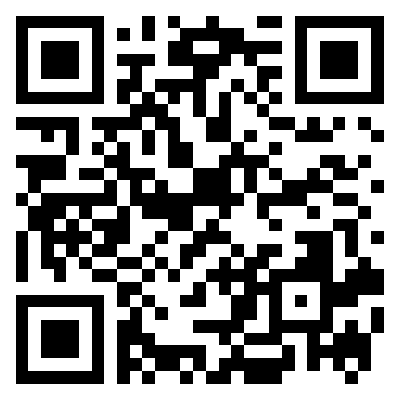
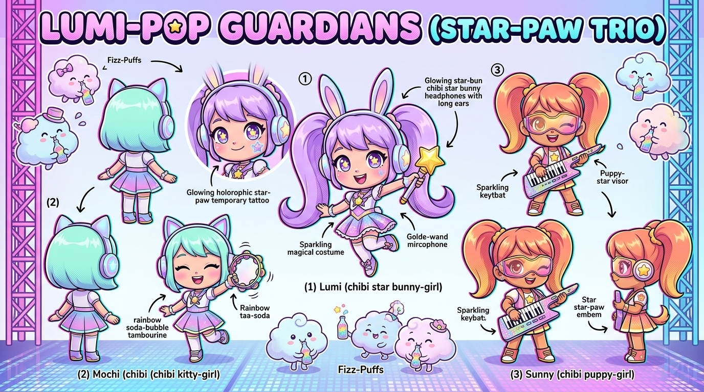
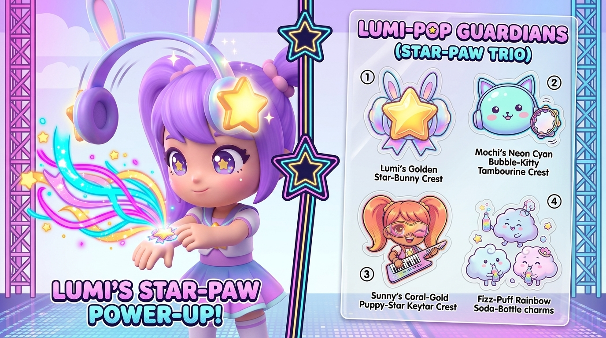
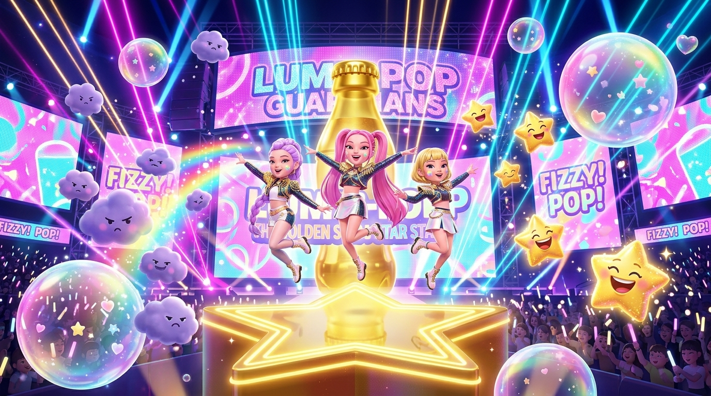

# 🌟 Lumi-Pop Guardians & K-Pop: Demon Hunters — Kids 3D Animation Theater

> **🌐 Live iPad Web App (GitHub Pages):** **[https://kunruiw1991.github.io/lumipop-kids-tv/](https://kunruiw1991.github.io/lumipop-kids-tv/)**

An iPad-first interactive **3D Animated K-Pop Sing-Along Theater** built for a 5-year-old child, combining:
1. **🐾 *Lumi-Pop Guardians: The Star-Paw Trio*** — An original, preschool-friendly 3D animated K-Pop magical-guardian mini-series (**Rumi-Bop**, **Mira-Mel**, and **Zoey-Zing**) rendered at **720p 24fps 3D motion animation (Veo 3.1)** with an original **124 BPM K-Pop anthem (*"Golden Soda Star!"*)** and interactive temporary-tattoo sticker power-ups.
2. **🎤 *K-Pop: Demon Hunters* (Pure Animated Movie Songs)** — 10 pure 3D animated concert stages and official sing-along music videos featuring **HUNTR/X** (*Golden*, *Takedown*, *What It Sounds Like*) and **Saja Boys** (*My Little Soda Pop*, *Your Idol*).

---

## 📱 How to Open on iPad & Install as a Home Screen App

| Scan with iPad Camera | One-Tap Home Screen Install |
| :---: | :--- |
|  | 1. Open **[https://kunruiw1991.github.io/lumipop-kids-tv/](https://kunruiw1991.github.io/lumipop-kids-tv/)** in **Safari** on the iPad.<br>2. Tap the **Share** button (`📤`) in the top bar.<br>3. Tap **Add to Home Screen** (`➕`).<br>4. Tap **Add** — **Lumi-Pop TV** now launches full-screen like a native iPad app! |

---

## 🎨 Meet the *Lumi-Pop Guardians* (Original 3D IP for 5-Year-Olds)

| 3D Character Turnaround Sheet | Magical Wrist Temporary Tattoo Crests | Golden Sky-Dome Concert Stage |
| :---: | :---: | :---: |
|  |  |  |
| **Rumi-Bop** (Berry-Magenta), **Mira-Mel** (Sunlit Cyan), & **Zoey-Zing** (Honey-Gold) | Printable glowing Star-Shield, Ribbon-Heart, & Soda-Bubble wrist stickers | 124 BPM concert stage where sleepy **Grumble-Bunnies** pop into rainbow soda-pop bubbles |

### 🎵 Sing-Along Lyrics: *"Golden Soda Star!"* (124 BPM)

```text
[Intro Voiceover — Rumi-Bop]
"One, two, three — Star-Paw shine!
Tap your glowing wrist sticker!
Let's pop the sleepy Grumble-Clouds into golden soda bubbles!
Ready? Jump, spin, and sing with Lumi-Pop!"

[Chorus]
Pop, pop, fizzy-pop! Golden Soda Star!
Tap your shiny sticker crest, glowing where you are!
One, two, jump up high! Spin around the floor!
Rumi, Mira, Zoey-Zing — let the music roar!
Golden, golden, shining bright!
Bye-bye Grumble-Bunnies — dance into the light!
```

---

## 🎬 Complete Hosted Video Playlist (14 Pure Animated `.mp4` Videos)

### 🐾 Channel 1: *Lumi-Pop Guardians 3D* (Veo 3.1 24fps 3D Animation)

| # | Video Title | Duration | Direct MP4 Stream |
| :-: | :--- | :-: | :--- |
| **01** | **Golden Soda Star! (Full 24s 3D Animated Music Video)** | `0:24` | [Watch `lumipop_mv_full.mp4`](https://kunruiw1991.github.io/lumipop-kids-tv/videos/lumipop_mv_full.mp4) |
| **02** | **Shot 1: Rumi-Bop Star-Shield Temporary Tattoo Power-Up!** | `0:08` | [Watch `lumipop_shot1.mp4`](https://kunruiw1991.github.io/lumipop-kids-tv/videos/lumipop_shot1.mp4) |
| **03** | **Shot 2: Golden Soda Star Stage Dance & Grumble-Bunnies!** | `0:08` | [Watch `lumipop_shot2.mp4`](https://kunruiw1991.github.io/lumipop-kids-tv/videos/lumipop_shot2.mp4) |
| **04** | **Shot 3: Star-Paw Trio Synchronized Choreography!** | `0:08` | [Watch `lumipop_shot3.mp4`](https://kunruiw1991.github.io/lumipop-kids-tv/videos/lumipop_shot3.mp4) |

### 🎤 Channel 2: *K-Pop: Demon Hunters* (10 Pure Animated Movie Videos)

| # | Video Title | Artist / Group | Duration | Direct MP4 Stream |
| :-: | :--- | :--- | :-: | :--- |
| **05** | **My Little Soda Pop (Animated Movie MV)** | *Saja Boys* | `2:40` | [Watch `dh_01_soda_pop.mp4`](https://kunruiw1991.github.io/lumipop-kids-tv/videos/dh_01_soda_pop.mp4) |
| **06** | **GOLDEN (Official Animated Sing-Along MV)** | *HUNTR/X* | `3:15` | [Watch `dh_02_golden_lyrics.mp4`](https://kunruiw1991.github.io/lumipop-kids-tv/videos/dh_02_golden_lyrics.mp4) |
| **07** | **Golden + TAKEDOWN Finale Concert Stage** | *HUNTR/X* | `3:42` | [Watch `dh_03_takedown_finale.mp4`](https://kunruiw1991.github.io/lumipop-kids-tv/videos/dh_03_takedown_finale.mp4) |
| **08** | **What It Sounds Like (Animated Movie MV)** | *HUNTR/X* | `4:29` | [Watch `dh_04_what_it_sounds_like.mp4`](https://kunruiw1991.github.io/lumipop-kids-tv/videos/dh_04_what_it_sounds_like.mp4) |
| **09** | **Your Idol (Animated Concert Stage)** | *Saja Boys* | `1:54` | [Watch `dh_05_your_idol_stage.mp4`](https://kunruiw1991.github.io/lumipop-kids-tv/videos/dh_05_your_idol_stage.mp4) |
| **10** | **Your Idol (Pure 3D Choreography Cut)** | *Saja Boys* | `1:58` | [Watch `dh_06_your_idol_cut.mp4`](https://kunruiw1991.github.io/lumipop-kids-tv/videos/dh_06_your_idol_cut.mp4) |
| **11** | **Soda Pop (Pure Animated Dance Cut)** | *Saja Boys* | `2:40` | [Watch `dh_07_soda_pop_cut.mp4`](https://kunruiw1991.github.io/lumipop-kids-tv/videos/dh_07_soda_pop_cut.mp4) |
| **12** | **Golden & Take Down Medley Animation** | *HUNTR/X* | `3:51` | [Watch `dh_08_golden_takedown.mp4`](https://kunruiw1991.github.io/lumipop-kids-tv/videos/dh_08_golden_takedown.mp4) |
| **13** | **Animated Movie Highlight Clip** | *HUNTR/X* | `0:55` | [Watch `dh_09_highlight.mp4`](https://kunruiw1991.github.io/lumipop-kids-tv/videos/dh_09_highlight.mp4) |
| **14** | **All Animated Movie Songs Medley** | *HUNTR/X & Saja Boys* | `4:10` | [Watch `dh_10_all_songs.mp4`](https://kunruiw1991.github.io/lumipop-kids-tv/videos/dh_10_all_songs.mp4) |
